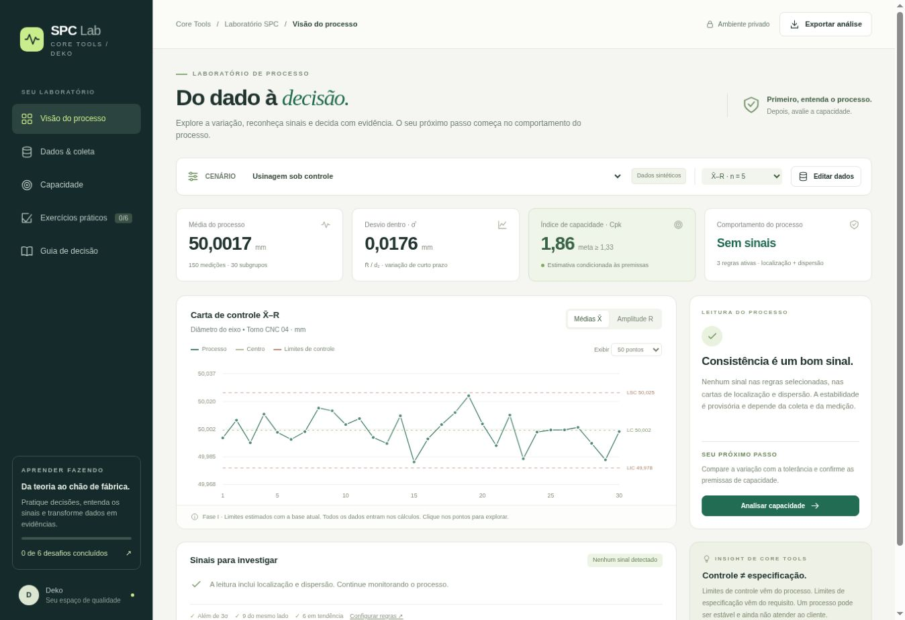
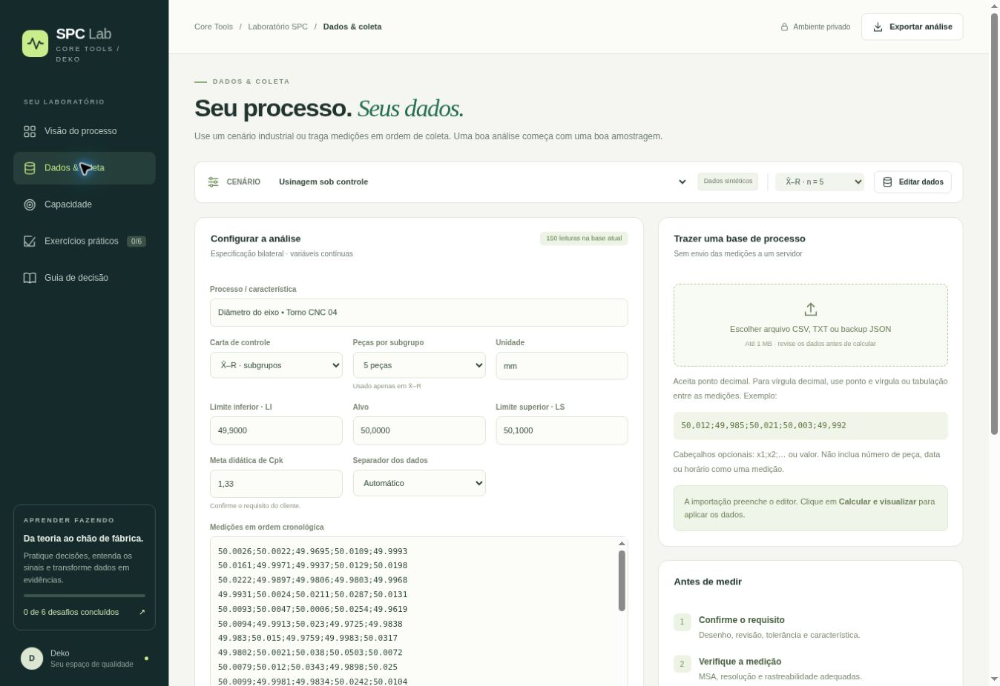
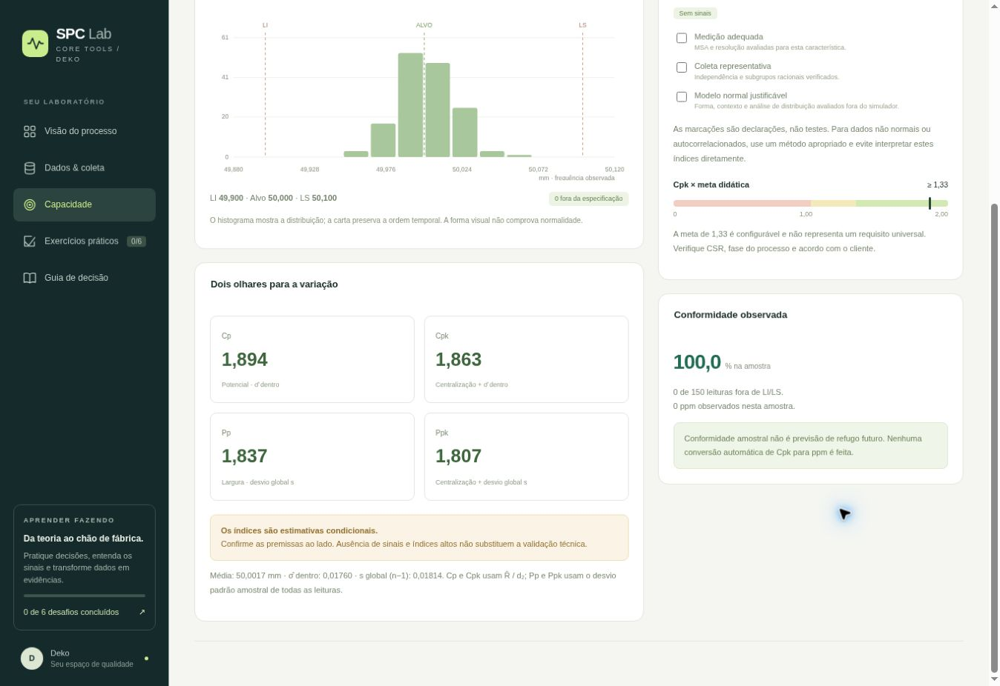
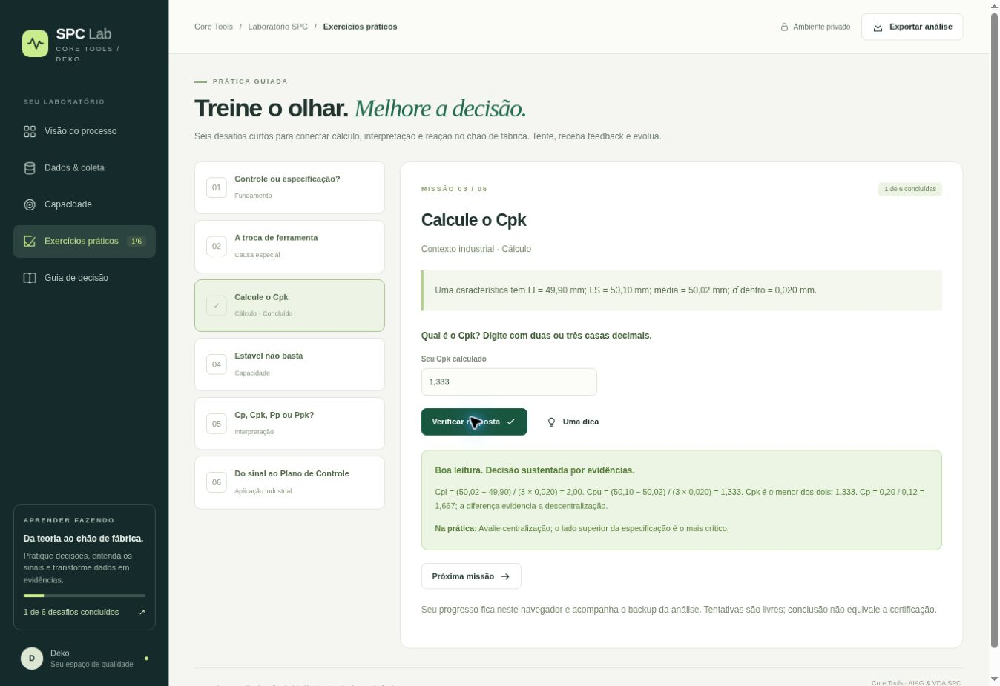
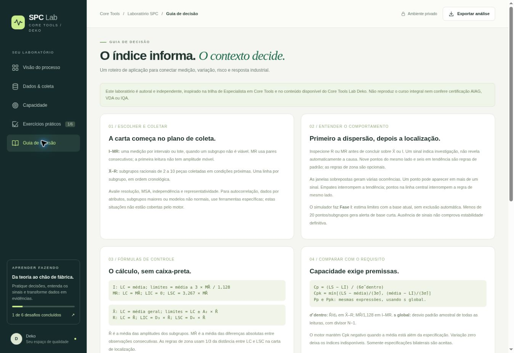
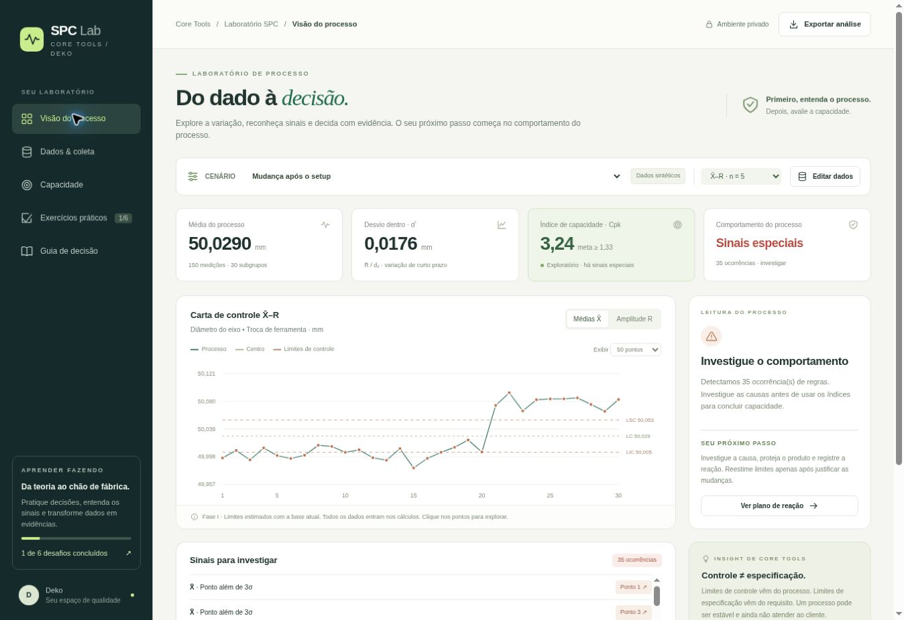

# SPC Lab · Core Tools

**Do dado à decisão: um laboratório interativo para aprender e aplicar Controle Estatístico de Processo (CEP/SPC).**

Projeto de **Wanderley Uchôa · DekoMao**, conectando Engenharia da Qualidade, análise de dados e aplicação industrial. A proposta é praticar a leitura do processo antes de concluir sobre sua capacidade.

[Guia de uso](docs/GUIA_DE_USO.md) · [Métodos estatísticos](docs/METODOS.md) · [Validação](docs/VALIDACAO.md) · [Como contribuir](CONTRIBUTING.md)



*Demonstração com dados sintéticos. Veja as demais [telas do simulador](#telas-do-simulador).*


## O problema que o projeto ajuda a resolver

Um Cpk alto, isoladamente, não demonstra que um processo é previsível. Uma peça dentro da tolerância também não garante que o processo esteja estável.

O SPC Lab transforma essa distinção em uma experiência prática: inserir medições, observar a sequência temporal, reconhecer sinais, comparar a variação com a especificação e escolher uma reação industrial coerente.

## O que você pode fazer

| Recurso | Aplicação |
| --- | --- |
| Cartas I–MR | Analisar medições individuais e amplitudes móveis entre pares consecutivos. |
| Cartas X̄–R | Analisar localização e dispersão com subgrupos racionais de 2 a 10 peças. |
| Indicadores | Média, desvio dentro, desvio global amostral, Cp, Cpk, Pp, Ppk e não conformes observados. |
| Regras de sinalização | Ponto além de 3σ, nove do mesmo lado, seis em tendência e regras de zona opcionais. |
| Entrada de dados | Colagem, CSV/TXT, cenários sintéticos e restauração de backup JSON. |
| Aprendizagem | Seis exercícios com dicas, correção e feedback ligado ao chão de fábrica. |
| Exportação | CSV, relatório Markdown e backup de dados, configurações e progresso. |

## Telas do simulador

As capturas mostram a interface real em desktop com bases sintéticas de treinamento. Clique nas seções para expandir cada tela.

<details>
<summary><strong>Dados & coleta</strong> — configuração da carta, especificação e entrada das medições</summary>



A tela reúne os parâmetros da análise, a seleção de regras e a entrada por colagem ou arquivo CSV/TXT.

</details>

<details>
<summary><strong>Capacidade</strong> — Cp, Cpk, Pp, Ppk e premissas de interpretação</summary>



Os estimadores de variação dentro e global são apresentados separadamente. As premissas continuam sendo verificações técnicas do usuário.

</details>

<details>
<summary><strong>Exercícios práticos</strong> — cálculo e feedback didático</summary>



O exemplo demonstra a correção de uma questão numérica e a conexão do resultado com a centralização do processo.

</details>

<details>
<summary><strong>Guia de decisão</strong> — coleta, controle e aplicação industrial</summary>



O guia documenta os métodos, as limitações e a reação a sinais, com referências para aprofundamento.

</details>

<details>
<summary><strong>Sinais especiais</strong> — mudança de patamar após o setup</summary>



Mesmo com Cpk alto, o cenário apresenta sinais temporais. Os índices são exploratórios enquanto o comportamento exigir investigação.

</details>

## Começar em três passos

Requisitos: **Node.js 22 ou superior** e um navegador com JavaScript e módulos ES. O ambiente local foi conferido com Node.js 24. Não há dependências npm a instalar.

```bash
git clone https://github.com/DekoMao/spc-lab-core-tools.git
cd spc-lab-core-tools
npm start
```

Abra **http://127.0.0.1:8080**. Para encerrar, pressione `Ctrl+C` no terminal.

Para usar outra porta:

```bash
# Linux / macOS
PORT=8090 npm start
```

```powershell
# Windows PowerShell
$env:PORT = 8090
npm start
```

Também é possível servir `dist/` com outro servidor estático. Evite abrir `index.html` diretamente com `file://`, pois a aplicação utiliza módulos JavaScript.

## Roteiro recomendado

1. Em **Visão do processo**, carregue “Usinagem sob controle”.
2. Compare as cartas de médias e de amplitude; clique em um ponto para inspecionar suas medições.
3. Em **Capacidade**, compare Cp/Cpk com Pp/Ppk e revise as premissas.
4. Carregue “Mudança após o setup”: observe por que um índice alto pode coexistir com sinais especiais.
5. Vá a **Dados & coleta** para aplicar sua própria base.
6. Consolide o aprendizado em **Exercícios práticos**.

## Cenários industriais

Todas as bases de treinamento são **sintéticas** e reproduzíveis.

| Cenário | Aprendizado |
| --- | --- |
| Usinagem sob controle | Comportamento sem sinais nas regras padrão e capacidade potencial favorável. |
| Mudança após o setup | Deslocamento de patamar após troca de ferramenta, mesmo com tolerância ampla. |
| Desgaste progressivo | Tendência temporal que exige investigação da condição de ferramenta. |
| Variação entre peças | Aumento da dispersão que pode ser pouco evidente na média. |
| Estável, mas fora da meta | Processo sem sinais nas regras padrão, mas com variação grande para a tolerância. |
| Processo descentralizado | Diferença entre Cp e Cpk quando a média se aproxima da especificação. |

## Importar medições

**X̄–R:** uma linha por subgrupo, exatamente `n` valores em cada linha. Exemplo para `n = 2`:

```csv
x1;x2
50,01;49,99
50,02;50,00
49,98;50,01
```

**I–MR:** uma leitura por linha, em ordem de coleta:

```csv
valor
50,01
49,99
50,02
50,00
```

Arquivos em `examples/` podem ser usados como referência de formato. São exemplos curtos, insuficientes para estabelecer uma base de controle industrial.

O importador aceita ponto decimal e vírgula decimal. Para usar vírgula decimal com várias medições na mesma linha, separe as colunas com ponto e vírgula ou tabulação. Não inclua horário, identificação de peça ou número de linha como se fossem medições. O limite é de **2.000 medições por análise** e **1 MB por arquivo**.

## Métodos e limites de interpretação

- Análise de **Fase I**: os limites são estimados com a base atual, sem remoção automática de observações.
- A dispersão é avaliada junto com a localização. Nas cartas R e MR, sempre é verificado ponto fora dos limites.
- Cp/Cpk usam σ̂ dentro, estimado por R̄/d₂ em X̄–R ou MR̄/1,128 em I–MR.
- Pp/Ppk usam o desvio padrão amostral global, com divisor `N−1`.
- A meta inicial de Cpk é `1,33`, **didática e configurável**; confirme o requisito do cliente.
- Menos de 20 pontos/subgrupos gera alerta de base preliminar. Isso é um critério didático do simulador, não uma aprovação normativa da amostragem.
- Não há testes automáticos de normalidade, independência, autocorrelação ou MSA. As marcações de premissas são declarações do usuário.
- Dados não normais, dados por atributos, subgrupos maiores e especificações unilaterais exigem métodos fora deste escopo.
- Índices com causas especiais são exploratórios. Ausência de sinal não comprova estabilidade definitiva.

Veja as fórmulas, constantes e critérios completos em [Métodos estatísticos](docs/METODOS.md).

## Testar

```bash
npm run check
npm test
```

A suíte contém **21 testes estatísticos**, incluindo referências calculadas manualmente, regras de sinalização, valores de fronteira, Cpk negativo, variação zero e leitura de CSV. A rotina de GitHub Actions está preparada para Node.js 22 e 24; consulte a aba Actions para acompanhar o resultado de cada execução.

A navegação desktop, troca de cenário, seleção de ponto, leitura de capacidade e feedback dos exercícios foram conferidos no navegador. O seletor nativo de arquivos e a inspeção visual móvel têm verificação pendente. O parser de CSV é coberto pelos testes automatizados. Detalhes em [Validação](docs/VALIDACAO.md).

## Privacidade e hospedagem

As medições e o progresso ficam no `localStorage` do navegador. A aplicação não envia essas medições a uma API nem sincroniza dados entre dispositivos. Para transferir ou preservar uma sessão, use o backup JSON.

O código é independente de serviços externos em tempo de execução. Hospedar arquivos estáticos **não implementa autenticação**: o controle de acesso depende da plataforma utilizada.

A instância atual é [privada e restrita ao proprietário](https://spc-lab-deko.rednote512.chatgpt.site). Este repositório não configura GitHub Pages, publicação automática ou mudança da audiência do site. A configuração e a identidade da hospedagem original não fazem parte deste pacote.

## Estrutura

| Caminho | Conteúdo |
| --- | --- |
| `dist/index.html` | Documento principal. |
| `dist/styles.css` | Interface e regras responsivas. |
| `dist/app.js` | Navegação, gráficos SVG, exercícios e persistência local. |
| `dist/engine.js` | Cálculos, regras estatísticas, parser e cenários sintéticos. |
| `scripts/serve.mjs` | Servidor de desenvolvimento sem dependências, restrito a loopback. |
| `tests/engine.test.mjs` | Testes automatizados do motor estatístico. |
| `examples/` | Modelos CSV sintéticos. |
| `docs/` | Guia operacional, métodos e evidências de validação. |
| `.github/workflows/ci.yml` | Conferência de sintaxe e testes, sem implantação. |

## Referências e autoria

- [NIST/SEMATECH — cartas de valores individuais](https://www.itl.nist.gov/div898/handbook/pmc/section3/pmc312.htm)
- [NIST/SEMATECH — cartas X̄, R e S](https://www.itl.nist.gov/div898/handbook/pmc/section3/pmc321.htm)
- [NIST/SEMATECH — capacidade de processo](https://www.itl.nist.gov/div898/handbook/pmc/section1/pmc16.htm)
- [NIST/SEMATECH — reação a sinais fora de controle](https://www.itl.nist.gov/div898/handbook/pmc/section1/pmc14.htm)
- [AIAG — AIAG & VDA SPC Manual](https://www.aiag.org/training-and-resources/manuals/details/SPCAV-1)

Projeto autoral e independente, inspirado na trilha de Especialista em Core Tools e no conteúdo disponível do Core Tools Lab Deko. Não reproduz a apostila integral do curso ou o manual licenciado e não representa treinamento, aprovação ou certificação oficial AIAG, VDA ou IQA.

O repositório utiliza `UNLICENSED`: não foi concedida licença aberta de redistribuição neste pacote.
